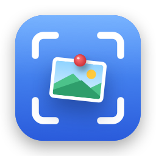

<p align="center">
  
</p>

<h1 align="center">Pinshot</h1>

<p align="center">
  画面をキャプチャして、そのまま最前面に浮かべておける macOS のメニューバーアプリ
</p>

<p align="center">
  <a href="LICENSE"></a>
  
  
</p>

> **English:** Pinshot is a macOS menu bar app that captures part of your screen and keeps it floating above other windows. You can annotate the floating image with arrows, text, numbered markers, mosaic, and more, then copy or save it. The UI is currently in Japanese.

## できること

- **キャプチャ**：範囲・ウィンドウ・画面全体・タイマー。グローバルショートカット（初期設定は `⌘⇧2`）で始められます
- **スクロールキャプチャ**：ブラウザなどのページを自動でスクロールしながら撮り、1 枚の縦長の画像につなぎます
- **最前面に浮かべる**：撮った画像はその場に浮かび、ほかのアプリを使っている間も見えたままです。拡大縮小・不透明度・クリックの透過もできます
- **書き込み**：四角・楕円・矢印・ペン・蛍光ペン・文字・番号・スポットライト・モザイク・ぼかし・トリミング。元に戻す・やり直す、スタイルの保存もできます
- **書き出し**：コピー・PNG で保存・ドラッグ＆ドロップ。余白・背景色・角丸・影を付けた見た目でも書き出せます
- **複数のディスプレイ**にも対応しています

くわしい操作は [docs/USAGE.md](docs/USAGE.md) を見てください。

## 動く環境

- macOS 14 以降
- ビルドするとき：Xcode 16 以降、[XcodeGen](https://github.com/yonaskolb/XcodeGen)

> いまはビルド済みのアプリを配布していません（Apple の Developer ID での署名・公証をしていないため）。ソースからビルドして使ってください。

## ビルドと起動

```bash
brew install xcodegen
git clone https://github.com/yzanbo/pinshot.git
cd pinshot
make cert   # 開発用の署名の証明書を作る（最初に一度だけ）
make run    # ビルドして起動する
```

| コマンド | 内容 |
|---|---|
| `make run` | 動いている Pinshot を終了し、ビルドして起動する |
| `make build` | ビルドだけ |
| `make test` | テストを動かす（アプリは起動しない） |
| `make stop` | 動いている Pinshot を終了する |
| `make generate` | `Pinshot.xcodeproj` を作るだけ（Xcode で開くとき） |
| `make icon` | アプリのアイコンを描き直す（`scripts/make-app-icon.swift` を変えたとき） |
| `make cert` | 開発用の署名の証明書「Pinshot Dev」を作る |

`Pinshot.xcodeproj` は `project.yml` から作るため、リポジトリには入れていません。

### `make cert` について

macOS は、画面収録の許可をアプリの署名にひも付けて覚えます。署名なし（アドホック署名）だと、ビルドし直すたびに別のアプリと見なされ、許可しても効かなくなります。そのため、自己署名の証明書「Pinshot Dev」をログインキーチェーンに作り、毎回それで署名します（[scripts/create-dev-cert.sh](scripts/create-dev-cert.sh)）。

証明書を作らずにビルドした場合や、許可しているのに案内の画面が出続ける場合は、システム設定の画面収録の一覧から古い Pinshot を「−」で消し、`make cert` → `make run` のあとで許可し直してください。

## 必要な許可とプライバシー

| 許可 | 使う場面 |
|---|---|
| 画面収録 | 画面を撮るのに必要です。初めてキャプチャするときに求められます |
| アクセシビリティ（任意） | スクロールキャプチャで、スクロールする部分を見つけて自動でスクロールするのに使います。許可しなくても、自分でスクロールすれば撮れます |

- Pinshot はネットワークに接続しません。撮った画像は Mac の中だけで扱います。ファイルに書き出すのは、保存したときと、ほかのアプリへドラッグ＆ドロップしたとき（一時フォルダに PNG を置く）だけです
- 背景にいるときもカーソルの形を変えるために、macOS の公開されていない API（CoreGraphics の `SetsCursorInBackground`）を使っています。このため、Mac App Store では配布できません

## 開発

- コードの構成と設計のメモ：[docs/ARCHITECTURE.md](docs/ARCHITECTURE.md)
- テスト：`make test`（書き込みのデータ・元に戻す・スクロールキャプチャのつなぎ合わせ・書き出しなど、画面に関係ない処理）

不具合の報告や提案は [Issues](https://github.com/yzanbo/pinshot/issues) へどうぞ。

## ライセンス

[PolyForm Shield License 1.0.0](LICENSE)

Pinshot のソースコードは公開していますが、オープンソースのライセンスではありません。使う・改変する・配ることはできますが、Pinshot と競合する製品（または、作者が Pinshot を使って提供する製品と競合する製品）を提供するために使うことはできません。正確な条件は、[ライセンスの本文](LICENSE)（英語）を見てください。
